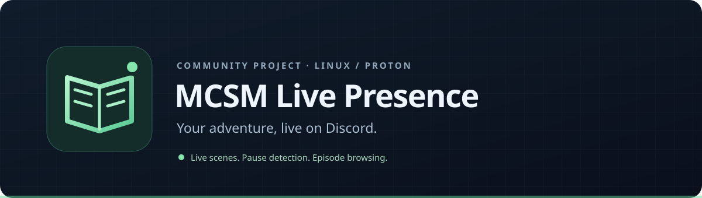

<div align="center">



**Your adventure, live on Discord.**

[](https://github.com/ShadyGames329/mcsm-live-presence/actions/workflows/ci.yml)


[](LICENSE)

Live Discord Rich Presence for **Minecraft: Story Mode — Season One**.
Built around game events, with a companion that runs only alongside your game.

[Get started](#get-started) · [How it works](docs/architecture.md) · [Troubleshooting](docs/troubleshooting.md) · [Contributing](CONTRIBUTING.md)

</div>

## A presence that follows the game

| In the game | On Discord |
| :--- | :--- |
| At the main menu | **Main Menu** |
| Choosing an episode | **Browsing Episodes** |
| Playing Episode 1 | **Episode 1: The Order of the Stone** · Wilderness |
| Opening the pause menu | **Paused** |
| Returning to gameplay | Episode and location return |

Scene identifiers are spaced for readability. The session timer continues across menus and pauses. Cover art and optional episode artwork use the asset keys from your Discord application.

**No save slots. No “last save” status. No background service.**

The companion reads local telemetry from the running game, not save files. Scene information uses a live scene string when available, with the current game script as a fallback. Chapter information is shown only when the runtime provides it; the tested session returned no chapter value, so chapter coverage is still limited.

## Compatibility

- **Game:** your own PC copy of Season One. This does not include the game or its assets.
- **Host:** Linux, Steam and Proton, with a local Discord desktop client exposing IPC.
- **Tools:** Python 3.11+, Git, and a Python virtual environment.
- **Status:** the game-side hooks and original companion were tested through main menu, episode browsing, gameplay, pause and resume on a local Linux/Proton setup. This portable source release has automated tests and local build verification; other game editions and native Windows/macOS launches are unverified.

## Get started

### 1. Install the source tools

```sh
git clone https://github.com/ShadyGames329/mcsm-live-presence.git
cd mcsm-live-presence
python3 -m venv .venv
.venv/bin/python -m pip install -e ".[mod]"
```

This downloads Python dependencies and the pinned open-source archive inspector. It does not install anything into the game. No Wine-based compiler is required.

### 2. Configure Discord

Create an application in the [Discord Developer Portal](https://discord.com/developers/applications). Set its name to **Minecraft: Story Mode** and copy its **Application ID** into your local config. A bot token is not needed.

```sh
mkdir -p ~/.config/mcsm-live-presence
cp config.example.json ~/.config/mcsm-live-presence/config.json
```

Edit `discord_application_id`. If you want artwork, add your own image in the application's Rich Presence assets and use its asset key in `large_image_key`. Set that key to an empty string to disable artwork. No game artwork is distributed here.

### 3. Build the mod locally

Close the game, then use its actual installation directory:

```sh
.venv/bin/python -m mcsm_live_presence build \
  --game-dir "$HOME/Games/Minecraft - Story Mode"
```

The builder reads your original archives and produces **two archives and two resource descriptors** in `build/mod/release/`. It verifies Lua structure, encrypted module round trips and packed file contents. It does not edit or install over your original archives.

Generated files contain derivatives of your game scripts. Keep them local; share this source repository instead. Every user builds from their own copy.

### 4. Install the four sidecar files

```sh
.venv/bin/python -m mcsm_live_presence install \
  --game-dir "$HOME/Games/Minecraft - Story Mode"
```

The installer refuses overwrites, detects earlier LiveState experiments, checks release hashes, and records the exact added files. If you used a development build before, remove it with its original manifest/tool first.

### 5. Launch alongside the game

Make the wrapper executable:

```sh
chmod +x scripts/launch.sh
```

In Steam's launch options, put the wrapper's **absolute path** before `%command%`:

```text
"/absolute/path/to/mcsm-live-presence/scripts/launch.sh" %command%
```

Keep any existing Proton or MangoHud settings to the left of the wrapper. Use one companion wrapper and one `%command%`. Keep Discord open, then launch through Steam.

The companion starts with the game and receives a shutdown signal when the game command exits. It clears its activity when Discord IPC remains available. Old telemetry from a previous launch is rejected.

## Configuration

| Key | Default | Purpose |
| :--- | :--- | :--- |
| `discord_application_id` | Required | Your Discord application’s numeric ID |
| `large_image_key` | `mcsm_cover` | Cover-art asset key, or `""` for no artwork |
| `episode_image_keys` | `{}` | Optional mapping such as `{"1": "episode_1"}` |
| `show_scene` | `true` | Hide scene/script identifiers when `false` |
| `poll_seconds` | `2` | Companion polling interval; Discord updates only when text changes |
| `state_directory` | XDG state directory | Telemetry and local logs |

Default state lives in `~/.local/state/mcsm-live-presence/`, or under `$XDG_STATE_HOME` when set. To change it, set `state_directory` in your config **and** pass the same absolute directory to the builder with `--state-dir`.

The builder normally converts that directory to Proton's `Z:` mapping. If your prefix uses another mapping, pass `--windows-state-dir` explicitly. Rebuild if you move the telemetry directory. A custom config file can be selected with the `MCSM_PRESENCE_CONFIG` environment variable.

## Uninstall

Close the game, then run:

```sh
.venv/bin/python -m mcsm_live_presence uninstall \
  --game-dir "$HOME/Games/Minecraft - Story Mode"
```

Every installed hash is checked before any file is removed. A changed or missing file stops removal for manual review. Original archives are untouched. Remove the wrapper path from Steam's launch options to stop starting the companion.

## Development

```sh
PYTHONPATH=src python3 -m unittest discover -s tests -v
lua tests/probe_mock.lua
bash -n scripts/launch.sh
```

Tests use synthetic inputs and mocked game APIs. CI tests Python on multiple versions and the probe with Lua 5.2. Local game archives are not needed for these tests and must not be attached to issues or pull requests.

See [architecture](docs/architecture.md), [troubleshooting](docs/troubleshooting.md), and [validation notes](docs/validation.md) for the implementation boundaries and test procedure.

## Credits

- [ttg-cli-inspector](https://github.com/haister/ttg-cli-inspector) by Haister — archive access, encryption and sidecar packaging. Used as a separately installed, pinned build dependency.
- [pypresence](https://github.com/qwertyquerty/pypresence) — Discord IPC.
- [Telltale Script Editor + Tweaks](https://github.com/Telltale-Modding-Group/Telltale-Script-Editor-Tweaks) — earlier local research and experiments.

This is an independent community project, unaffiliated with Mojang, Microsoft, Telltale or Discord. Minecraft: Story Mode and related names belong to their respective owners. The [MIT license](LICENSE) covers this project's original source; it does not grant rights to game assets or third-party software.
