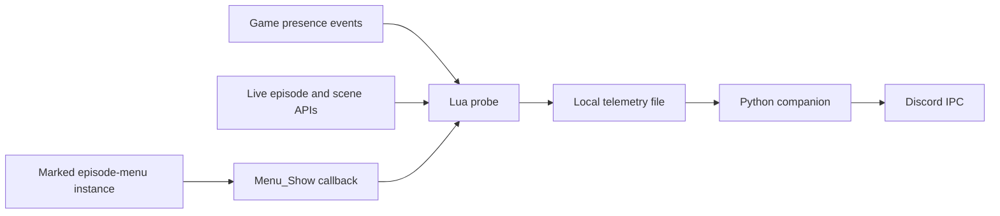

# Architecture

## Game-side hooks

The local builder reads three original scripts from the user's game. It adds protected module loading after `RichPresence.lua` and `Menu.lua` initialization, then instruments `Menu_Show` with a protected callback. New scratch registers preserve the original arguments and captured locals. Relative jumps and existing instructions are preserved.

The episode-selection constructor receives one additional instruction after its verified `Menu_Create` call. This adds a private `__MCSM_episodeBrowser` field to the returned menu instance. It does not alter any existing menu field. The callback reads that marker when a menu is shown and reports browser enter/leave to the shared probe.

This detail matters: the template's existing `isEpisodeSelect` flag was absent from actual menu objects during testing. Checking it repeatedly did not detect browsing. The private instance marker is the tested solution.

The probe wraps `RichPresence_Set` and `RichPresence_RestoreLogic`, preserves their return values, and observes menu/gameplay/pause events. Private observer messages are consumed before reaching the game's original presence function.

## Runtime metadata

The probe queries `SubProject_GetCurrent` or `SubProject_GetEpisodeNumber` for the episode. It uses a string from `Game_GetScene` when possible, otherwise the live `Game_GetCurrentScript` value. It also queries the in-memory `SaveLoad_GetChapterID`; that is a runtime getter, not a file read, but its update timing is unverified and it returned empty in the recorded test.

A game coroutine uses `ThreadStart` and `Sleep(0.5)` to resample changes. The file is rewritten only when state or metadata changes. This is event/state sampling, not a telemetry heartbeat. A missing optional API yields missing metadata rather than guessed values.

## Companion

The companion polls the small file and validates format, fields, mode/key consistency, size, UTF-8, final newline and current-launch modification time. It rejects partial writes and stale data. Episode/chapter/scene are displayed only during gameplay. No save file is read, no save slot is displayed, and missing metadata is not filled from old progress.

Discord updates are sent only when the payload changes. The Steam wrapper preserves the game command and exit code, starts one companion, and terminates it when the game command exits. The companion attempts to clear its activity before closing IPC.

## Local builds and installation

`ttg-cli-inspector` is a separately installed build dependency. This repository does not vendor its decryption profiles, keys or implementation. All game-derived archives and scripts are generated locally into ignored build output.

Project and Menu resources use separate logical destinations with priority 1100. Each sidecar is paired with a descriptor. The installer adds four files using exclusive creation, records their hashes, and never replaces an original archive. Uninstall verifies the complete set before removing anything.

The patcher supports the inspected little-endian Lua 5.2 layout with 32-bit numbers. Unexpected script layouts or constructor instructions cause a build failure instead of a speculative patch.
